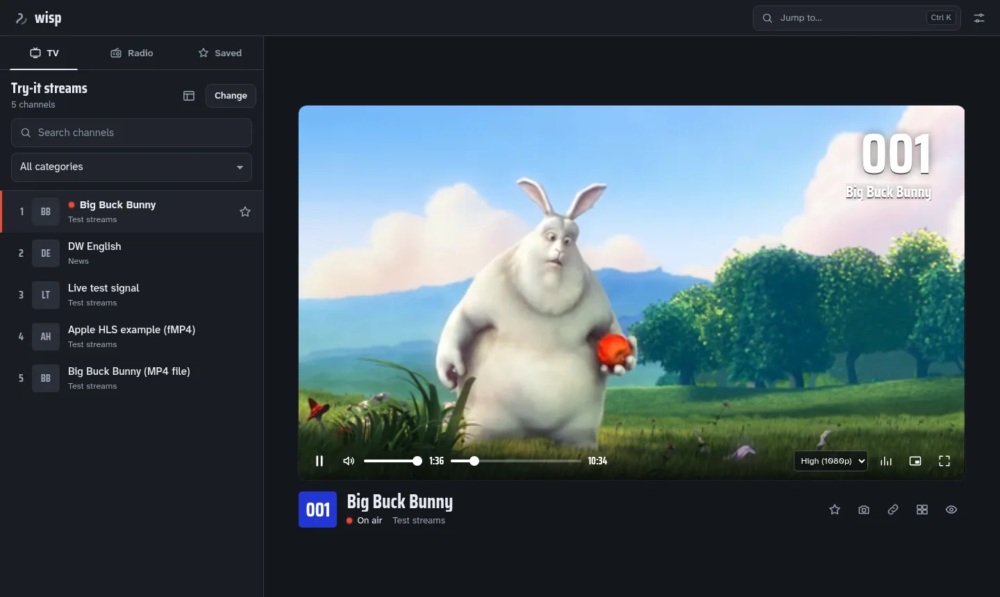
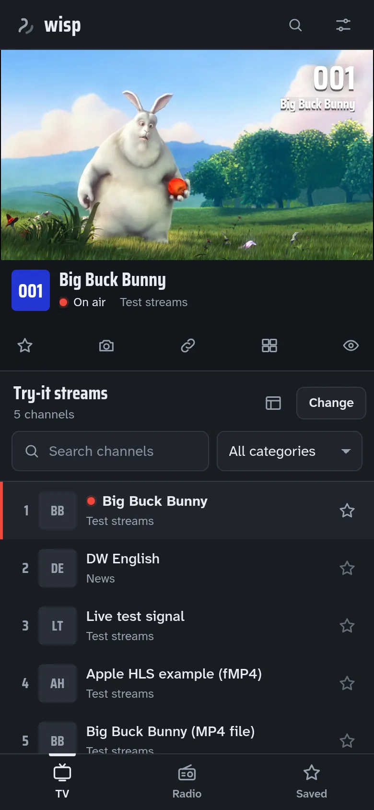

# Wisp

A fast, lightweight player for HLS / IPTV playlists and internet radio that runs entirely in your browser.

Paste an M3U playlist or a stream link and Wisp shows the channels, grouped and searchable, and plays them with adaptive streaming tuned for slow and unstable connections. Switch to **Radio** to browse more than 40,000 internet radio stations from the free [Radio Browser](https://www.radio-browser.info) directory.

<p>
  
  
</p>

## What Wisp is, and what it isn't

- **Wisp is a generic media player**, in the same spirit as VLC. It plays links that *you* provide.
- **Wisp hosts no content.** It doesn't bundle, host or recommend any channel list or playlist, and it has no server. Streams go directly from their source to your browser.
- **Wisp keeps no data about you.** No accounts, analytics, ads or tracking. Favorites, history and settings stay in your browser's local storage.

You're responsible for making sure you have the right to watch or listen to the streams you open.

## Features

- **TV:** open an M3U/M3U8 playlist by link, by pasting its text, or from a file. Channels are grouped by category, numbered, searchable, and scroll smoothly even with 10,000+ entries.
- **Direct links:** HLS streams (`.m3u8`) and video/audio files (`.mp4`, `.webm`, `.mp3`, …) play straight away.
- **Smart detection:** one box takes a link or pasted playlist text. Wisp peeks at the first bytes of a link to see what it really is. The optional *Type* menu is only a hint: if it's wrong, Wisp tries the other ways of playing the link before giving up.
- **Radio:** search more than 40,000 stations by name, country or genre.
- **Programme guide (optional):** add an XMLTV guide (link, pasted XML, or a `.xml`/`.xml.gz` file) to see what's on now and next. If the playlist names a guide (`x-tvg-url`), Wisp offers it. Guides are parsed in a background worker and cached for 12 hours.
- **Multiview:** watch up to four streams in a grid. The screen with the red tally frame has the sound. The others are muted and kept at their lowest quality to save bandwidth.
- **Live stream stats:** resolution, stream bitrate, measured download speed, buffer and latency, with a one-minute graph of speed against bitrate.
- **Command palette:** Ctrl K (⌘ K on a Mac) jumps to any channel, saved item or radio station, or runs an action.
- **Backup sources:** when a playlist lists the same channel more than once, the other entries are tried automatically if the one you picked fails.
- **Background data saver:** when Wisp's tab is hidden, the stream drops to its lowest quality. Sound keeps playing, and picture-in-picture counts as visible.
- **Zen mode, picture-in-picture, snapshots, and touch gestures:** swipe up or down on the picture for volume (right side) or brightness (left side).
- **Favorites and recently played**, plus export and import of everything as a JSON file, to move to another browser. There are no accounts.
- **Resume and shareable links:** reopening Wisp picks up where you left off. `?stream=<url>` opens and plays a stream, and a shared link always wins over resume.
- **Quality:** Auto (adaptive), or lock to Low / High.
- **Installable app (PWA):** after the first visit, the app opens instantly, even offline.
- **Lock-screen controls** through the Media Session API, including next and previous channel.

### Keyboard shortcuts

| Key | Action |
| --- | --- |
| Ctrl K / ⌘ K | Jump to a channel, station or action |
| ↑ / ↓, Page Up / Page Down, Home / End | Move through the list |
| Enter | Play the highlighted channel or station |
| * | Add or remove the highlighted item as a favorite |
| Space or K | Play / pause |
| / | Search the list |
| F | Fullscreen |
| M | Mute |
| I | Stream stats |
| P | Picture-in-picture |
| S | Snapshot of the picture |
| G | Multiview on / off |
| 1 – 4 | Listen to that multiview screen |
| Z | Zen mode (↑ / ↓ change channel, Esc leaves) |
| Page Up / Page Down (outside a list) | Previous / next channel |

## Try it

Paste any of these into the **TV** tab:

| What | Link |
| --- | --- |
| Big Buck Bunny, an adaptive HLS test stream (Mux) | `https://test-streams.mux.dev/x36xhzz/x36xhzz.m3u8` |
| DW English, live (Deutsche Welle's official public stream) | `https://dwamdstream102.akamaized.net/hls/live/2015525/dwstream102/index.m3u8` |
| Live test signal with separate audio tracks (Unified Streaming demo) | `https://demo.unified-streaming.com/k8s/live/stable/scte35.isml/.m3u8` |
| Apple's HLS example, fMP4 | `https://devstreaming-cdn.apple.com/videos/streaming/examples/img_bipbop_adv_example_fmp4/master.m3u8` |
| A plain MP4 file | `https://test-videos.co.uk/vids/bigbuckbunny/mp4/h264/360/Big_Buck_Bunny_360_10s_1MB.mp4` |

Or open one directly: `https://<your-wisp-domain>/?stream=https%3A%2F%2Ftest-streams.mux.dev%2Fx36xhzz%2Fx36xhzz.m3u8`

To try a large channel list, community projects such as [iptv-org](https://github.com/iptv-org/iptv) publish playlists of publicly available channels. Wisp isn't affiliated with them.

These links belong to third parties and may change or stop working.

## Why some streams won't play

Wisp runs entirely in the browser with no proxy server. That keeps it free to host and simple to trust, but browsers enforce rules that native apps like VLC don't have to follow:

- **CORS:** a stream's server has to allow playback from other websites. Many IPTV servers don't. If a *playlist* link is blocked, open it in a new tab, copy its text and paste it into the box, or download it and use **Choose file**. The channels inside often play fine.
- **Mixed content:** secure (`https://`) pages can't load `http://` streams. Wisp automatically tries the `https://` version first, and explains the problem if there isn't one.
- **Custom headers:** some playlists ask for a specific `User-Agent` or `Referer` (`#EXTVLCOPT:http-user-agent=…`). Browsers don't let websites set those headers, so such channels only work in native players. Wisp does send any other custom headers a playlist specifies. It also never sends a `Referer` of its own, because many CDNs block foreign referrers but allow none.
- **Formats:** raw MPEG-TS (`.ts`) channels, MPEG-DASH (`.mpd`) and DRM-protected streams aren't supported.
- **Geo-blocking and dead links:** Wisp says so quickly instead of spinning forever. It tries each way of playing a link (and any backup sources) in turn, and shows a clear message with **Try again** within 30 seconds at most. A server that doesn't answer at all is given up on after 8 seconds.
- **Programme guides** are subject to the same CORS rule. If a guide link is blocked, download the file and choose it, or paste its XML.

## Development

Requires Node.js 22.12 or newer.

```sh
npm install
npm run dev       # dev server at http://localhost:5173
npm test          # unit tests (Vitest)
npm run build     # production build in dist/
npm run preview   # serve the production build locally
```

### Deploying

`dist/` is a plain static site. On [Vercel](https://vercel.com), import the repository and deploy; `vercel.json` sets the build command, the security headers (Content Security Policy, `no-referrer`) and cache headers. Any static host works the same way.

## How it works

```
input (link, pasted text, file, ?stream=)
  └─ lib/source.js        what is it? peeks at the first bytes: channel list, HLS, video, audio
       ├─ lib/m3u.js      parse and sanitize the playlist → channels, groups, guide link
       └─ state.js        signals: playlist, current item, status, favorites, multiview …
            └─ playback.js (usePlayback hook) → lib/player.js
                 tries each source × engine in turn:
                 ├─ hls.js (fetched once a playlist is open; transmuxes in a worker)
                 ├─ native HLS (older iOS Safari)
                 └─ native <video>/<audio> (files and most radio streams)
lib/epg.worker.js         streams, un-gzips and scans XMLTV guides off the main thread
```

- **Stack:** [Preact](https://preactjs.com) with [signals](https://preactjs.com/guide/v10/signals/), [hls.js](https://github.com/video-dev/hls.js) and [Vite](https://vitejs.dev). No CSS framework.
- **Fast first paint:** the app shell is about 33 KB of gzipped JavaScript. hls.js (about 180 KB) is never part of it: it's fetched while the browser is idle once a playlist is open, or alongside the link check when you paste a stream, so it's usually ready before the first channel starts. Its transmuxer runs in a Web Worker (one shared by every multiview screen), keeping the page responsive. Stats, multiview, the command palette, the guide and settings are separate chunks of 1–3 KB each, loaded when first used; the palette is fetched while the browser is idle. The service worker caches all of it, so later visits start instantly.
- **Quick to start:** a pasted link's first bytes are checked to see what it is, while hls.js loads in parallel. The answer is remembered for the session, so opening it again skips the check. Channels from a playlist aren't checked at all; they start straight away. If the check is blocked by CORS, the browser's own player goes first, since hls.js would be blocked too.
- **Built for poor connections:**
  - Small forward buffer (20 s) and back buffer (30 s), so long live sessions don't keep growing in memory.
  - Short load timeouts with few retries.
  - Quality steps down quickly and steps up cautiously.
  - The first quality guess comes from the Network Information API where the browser provides it, and data saver or 2G starts at the lowest quality.
  - Resolution is capped to the player's size.
  - Muted multiview screens and hidden tabs only ever download the lowest quality.
- **Large playlists and guides:** the list is virtualized, so only visible rows exist in the page. Logos load lazily, and broken ones are remembered. XMLTV guides of tens of megabytes are parsed in a worker (about 2 seconds for 47 MB) without blocking the page.
- **Untrusted data:** everything from playlists, guides, the radio directory and imported settings files is treated as hostile. Text is stripped of control characters and rendered as text, never as HTML. Only `http(s)` links are accepted. A strict Content Security Policy is set on deploy.
- **Graceful failure:** errors say what went wrong (offline, CORS, 403/404, unsupported format, raw MPEG-TS, a web page instead of a stream, http-on-https) and offer **Try again** or **Next channel**.

### Design

Wisp looks like a TV set's own on-screen display. The monitor is the one bold element: the blue "no signal" screen, the channel number keyed into the corner when you change channel, test bars and a scan line while tuning, and a lower third with the channel number, name and on-air tally. Everything around it stays quiet, apart from the list cursor, a solid blue bar like a TV menu's. On phones the section tabs become a bottom bar and settings open as a bottom sheet. The palette, type (Saira Condensed and Atkinson Hyperlegible Next, self-hosted) and motion rules are described at the top of [`src/styles.css`](src/styles.css).

### Not included

- **MPEG-DASH (`.mpd`)** would need a second engine; it would slot in next to hls.js in `lib/player.js`'s try-chain.
- **Raw MPEG-TS** channels would need [mpegts.js](https://github.com/xqq/mpegts.js).
- **Casting (Chromecast/AirPlay)** and **audio/subtitle track menus** are also left out.
- There is no built-in channel directory, by design.

## License

[MIT](LICENSE)
